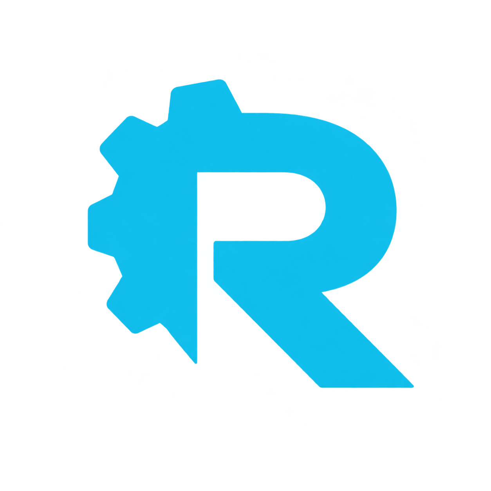
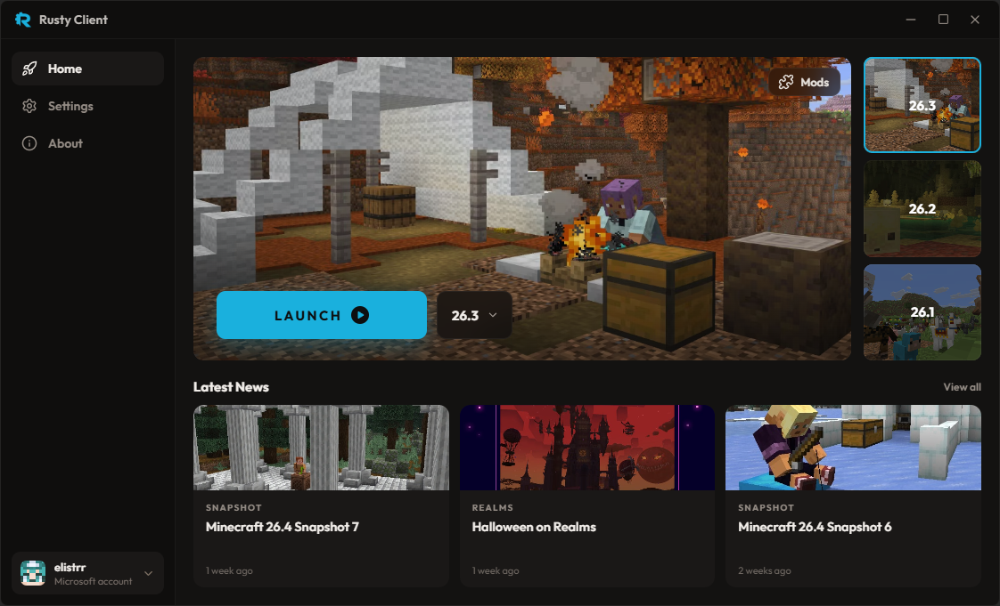
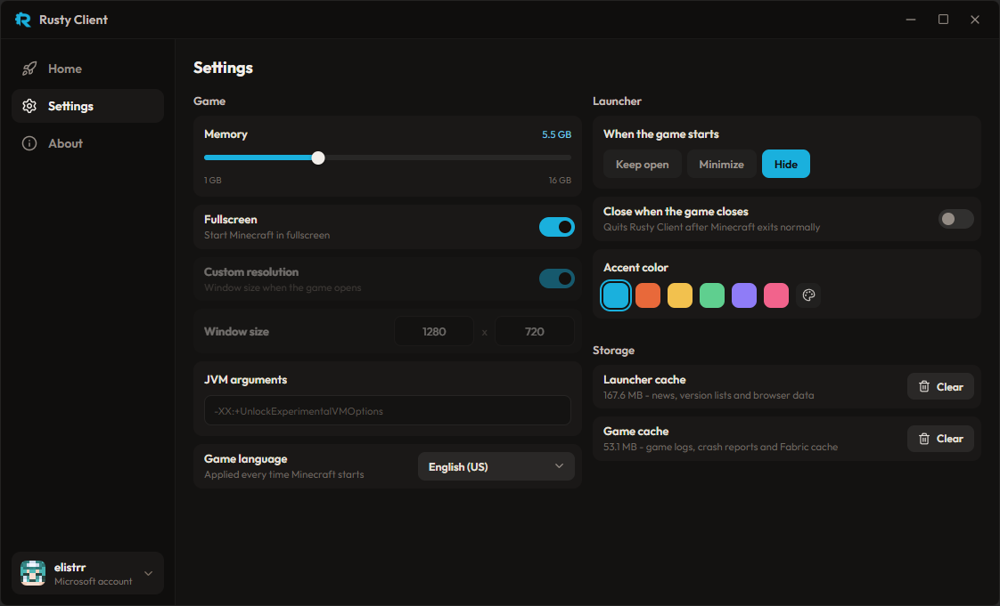
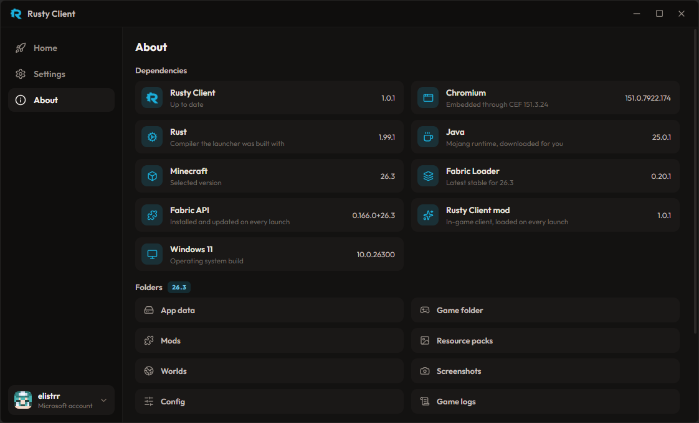
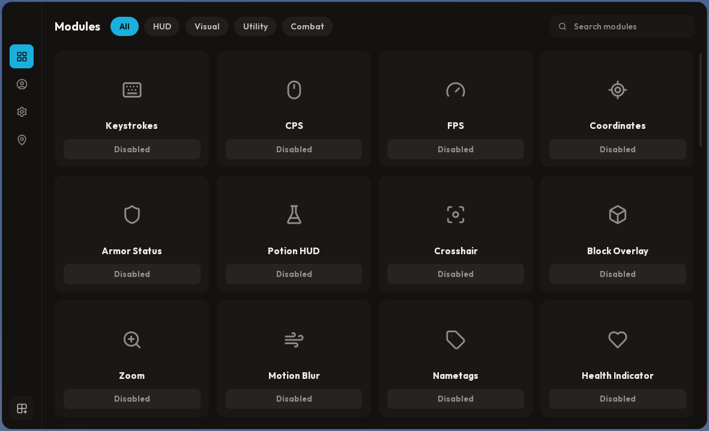
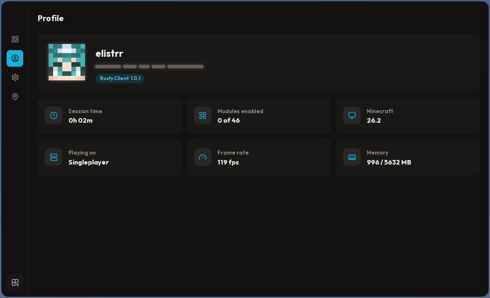
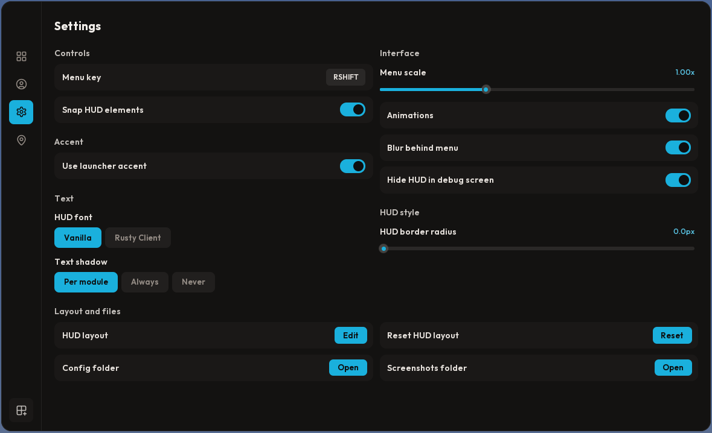

  

<h1 align="center">Rusty Client</h1>

  
  
  
  
  
  

A fast, lightweight Minecraft launcher written in Rust. Sign in with your Microsoft account, pick a version and play. Java, Fabric and Fabric API are all set up for you.

## Features

- **One click play** for every release of Minecraft 26.1, 26.2 and 26.3
- **Microsoft sign-in** with support for multiple accounts
- **Java included**: the right Java runtime is downloaded automatically, nothing to install yourself
- **Fabric ready**: Fabric Loader and Fabric API are installed and kept up to date on every launch
- **Mod manager**: drop `.jar` files in, turn mods on and off or remove them, per version
- **Official news** and version art straight from Mojang
- **Your look**: pick an accent color for the whole launcher
- **Crash help**: when the game crashes you get the reason and the crash report in one click

## Screenshots

### Launcher

  

  
  

### In-game menu

Every launch also loads the Rusty Client mod. Press Right Shift in game to open its menu with all modules, your profile and the client settings.

  

  
  

## Download

Grab the latest build from the [Releases](../../releases) page. There are two ways to run it:

| File | What it is |
| --- | --- |
| `RustyClient-Setup.exe` | Installer. Adds desktop and Start menu shortcuts and an entry in Windows Apps for uninstalling. |
| `RustyClient.exe` | Portable. A single file, no install needed, run it from anywhere. |

## Requirements

- Windows 10 or 11, 64-bit
- A Microsoft account that owns Minecraft: Java Edition
- About 1 GB of free space for the game, Java and assets

## Where your data lives

Everything Rusty Client saves goes into `%APPDATA%\.rustyclient`: settings, accounts (encrypted with Windows), game files and one game folder per version with its own worlds, resource packs, screenshots and mods. Uninstalling the launcher keeps this folder, so nothing is lost.

## Fair play

Rusty Client is meant for normal play on any server. It does not include, and will not add, anything that gives an unfair advantage.

## License

Rusty Client is free software under the [GNU General Public License v3.0](LICENSE). Bundled fonts and icons, and the Chromium Embedded Framework that Rusty Client downloads on first start, are listed in [THIRD_PARTY.md](THIRD_PARTY.md).

Rusty Client is not affiliated with Mojang Studios or Microsoft.
